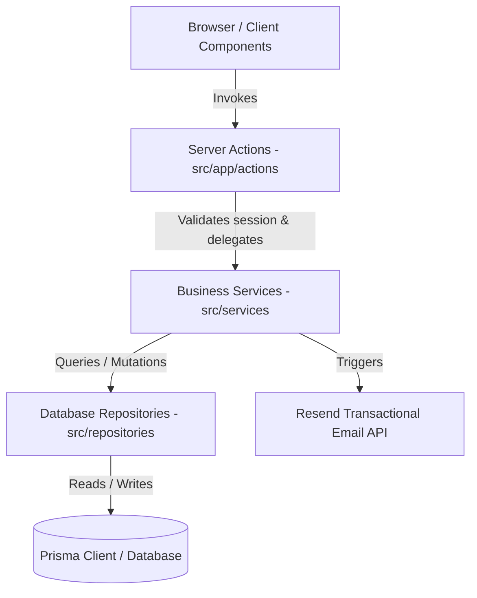
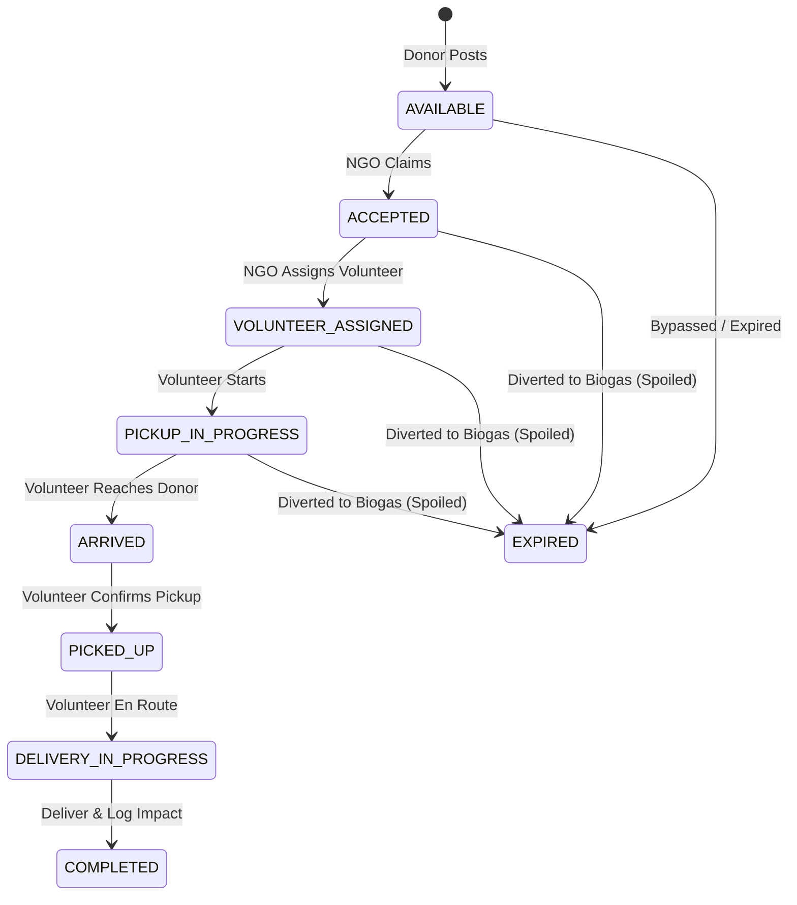

# System Architecture - FoodOps Phase 2

FoodOps follows a **Layered Clean Architecture** structure to separate concerns, ensure testability, and decouple presentation/delivery components from database models.

---

## 1. Structural Layers

### 1.1 Presentation Layer (Next.js Server Actions)
- Located in `src/app/actions/`.
- **Responsibilities:**
  - Authenticate the client session (`getSession`).
  - Enforce user roles (e.g. `DONOR`, `NGO`, `VOLUNTEER`, `ADMIN`).
  - Parse form inputs.
  - Call the business Service layer.
  - Revalidate cache paths (`revalidatePath`) to refresh UI states.
- **Rules:** Must contain zero direct SQL or database query commands.

### 1.2 Service Layer (Business Domain)
- Located in `src/services/`.
- **Responsibilities:**
  - Coordinate workflows across multiple repositories.
  - Apply calculations (e.g., Haversine distance, water savings, carbon emissions).
  - Enforce state machine transitions (e.g., preventing claim acceptance for expired listings).
  - Trigger transactional email notifications (via Resend REST fetch API).
  - Handle atomic interactive database transactions (`prisma.$transaction`).

### 1.3 Repository Layer (Data Access Abstraction)
- Located in `src/repositories/`.
- **Responsibilities:**
  - Abstracts all Prisma client calls.
  - Provides cleanly structured models queries.
  - Supports passing transaction clients (`TxOrPrisma`) to execute operations atomically.

---

## 2. Key Logistics Engines

### 2.1 The Matching Engine
1. **Bounding Box Calculation:** Filters out-of-range listings before performing complex trig calculations, limiting queries by latitude/longitude boxes.
2. **Haversine Distance Filter:** Computes the exact spherical distance between the donor and NGO.
3. **Category Compliance Matcher:** Verifies if the NGO accepts the specific food group (e.g., grains, bakery items, veg vs. non-veg) before notifying or displaying.

### 2.2 Donation Lifecycle State Machine

