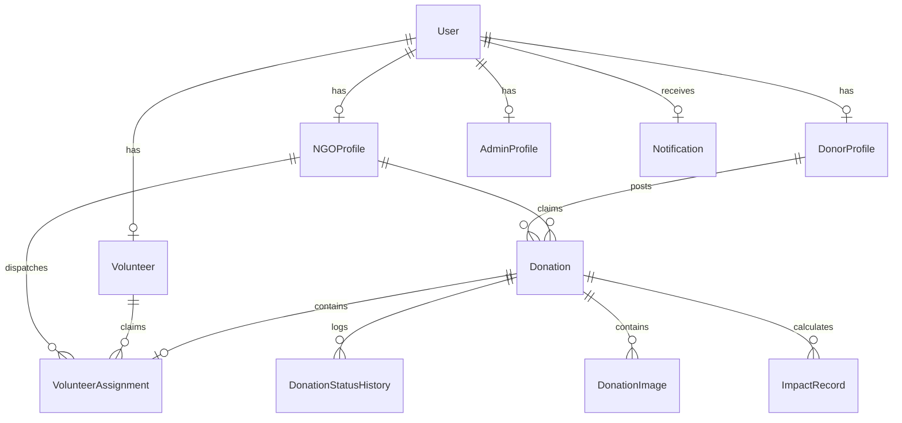

# Database Design & Optimization - FoodOps Phase 2

FoodOps supports PostgreSQL in production and SQLite in development.

## 1. ER Schema Relations & Delete Rules

### 1.1 Deletion Constraints
- **Profiles:** User deletions cascade (`onDelete: Cascade`) to clear profiles (`DonorProfile`, `NGOProfile`, `Volunteer`, `AdminProfile`).
- **Assignments:** Volunteer assignments use strict restrictions (`onDelete: Restrict` or implicit standard constraints) to prevent deletion of active delivery histories when purging users, protecting log integrity.
- **Audit Trails:** `DonationStatusHistory` uses `onDelete: Cascade` bound to the parent `Donation`.

---

## 2. Optimization and Indexes

### 2.1 Index Placement
To ensure optimal performance in production PostgreSQL clusters under heavy query loads, indexes are placed on fields used in `WHERE` filters, ordering, and joining:

1. **User Lookup:** `User.email` is marked `@unique` (implicitly indexed).
2. **Logistics Bounding Box:** Bounding coordinates require queries on `pickupLatitude` and `pickupLongitude`. Compound coordinates indexes can be applied for production.
3. **Relation Indexes:** Foreign key identifiers like `userId`, `donorId`, `acceptedNgoId`, and `volunteerId` are mapped to ensure quick JOIN operations.

---

## 3. Atomic Transaction Locking
- **Race Condition Prevention:** When an NGO claims a donation, a race condition could occur if two NGOs query `AVAILABLE` at the same microsecond and issue writes.
- **Solution:** `donationService.acceptDonation` uses `prisma.$transaction`.
  - In PostgreSQL, interactive transactions issue lock rows or wait statements during queries, ensuring only one transaction updates the state to `ACCEPTED` successfully while other conflicting attempts fail with a `DONATION_ALREADY_ACCEPTED` exception.
  - In SQLite, the interactive transaction acquires an exclusive write lock on the database file, ensuring absolute serialization.
